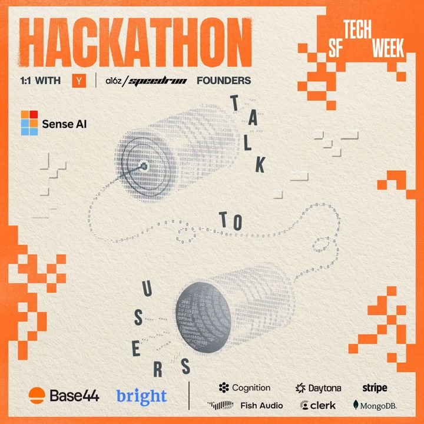
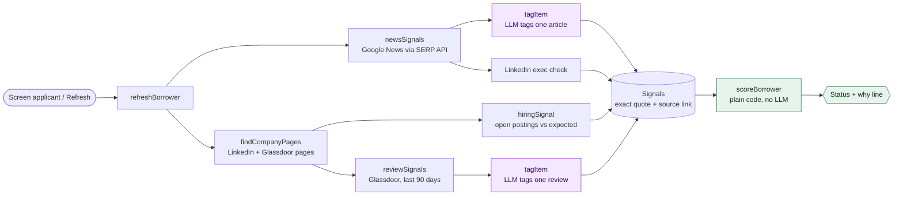
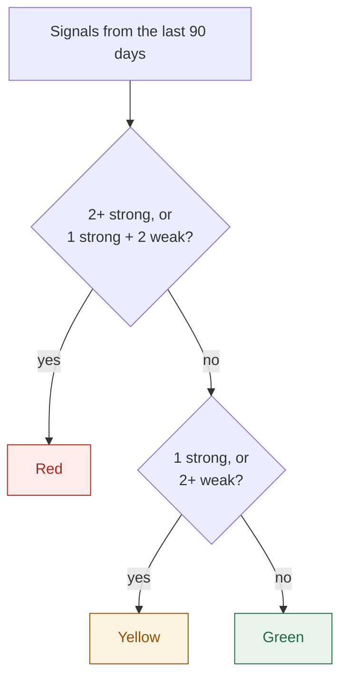
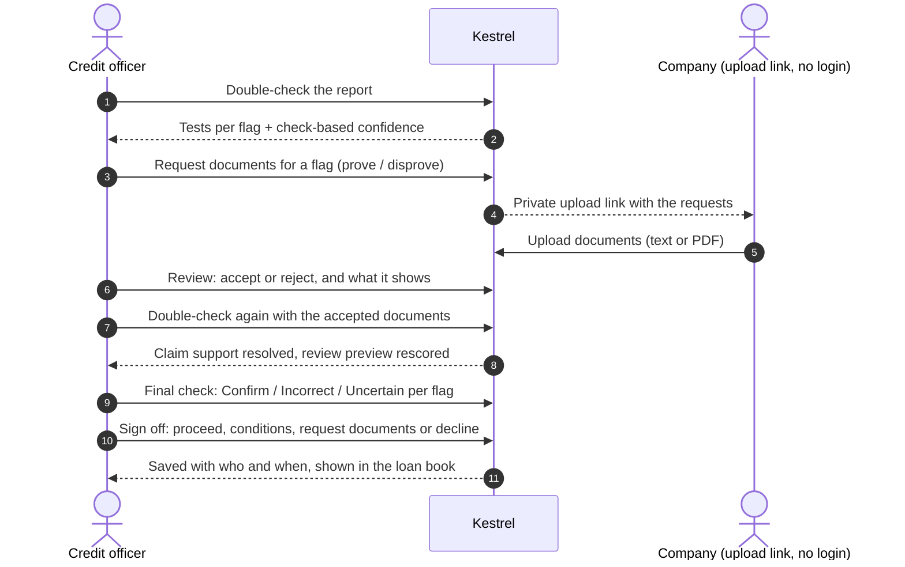

<p align="center">
  <a href="https://kestrel-app.base44.app/welcome">
  <picture>
    <source media="(prefers-color-scheme: dark)" srcset="public/brand/kestrel-mark-white.svg">
    
  </picture>
  </a>
</p>

<h1 align="center">Kestrel</h1>

<p align="center"><a href="https://kestrel-app.base44.app/welcome"><b>kestrel-app.base44.app/welcome</b></a> · no account needed, choose “Explore the demo”</p>

<p align="center">
  <a href="https://kestrel-app.base44.app/welcome"></a>
  <a href="https://github.com/hjun-escape/Kestrel/actions/workflows/ci.yml"></a>
</p>
<p align="center">
  <a href="https://base44.com"></a>
  <a href="https://brightdata.com"></a>
  <a href="https://testwithsenseai.com"></a>
  
  
  
  
</p>

<p align="center">
  <br>
  <sub>Built at the <b>Talk to Users Hackathon</b> · SF Tech Week · Group 17</sub>
</p>

<h3 align="center">Contributors</h3>

<table align="center">
  <tr>
    <td align="center" width="140">
      <a href="https://github.com/comp-Ryan"><br><b>Ryan</b></a><br>
      <a href="https://github.com/comp-Ryan"><sub>@comp-Ryan</sub></a>
    </td>
    <td align="center" width="140">
      <a href="https://github.com/RonKat2008"><br><b>Ronit Katikaneni</b></a><br>
      <a href="https://github.com/RonKat2008"><sub>@RonKat2008</sub></a>
    </td>
    <td align="center" width="140">
      <a href="https://github.com/hjun-escape"><br><b>Hyeseong Jun</b></a><br>
      <a href="https://github.com/hjun-escape"><sub>@hjun-escape</sub></a>
    </td>
    <td align="center" width="140">
      <a href="https://github.com/natephunt"><br><b>Nathan</b></a><br>
      <a href="https://github.com/natephunt"><sub>@natephunt</sub></a>
    </td>
  </tr>
</table>

<p align="center">
  <a href="https://testwithsenseai.com"></a>
  User tested with <a href="https://testwithsenseai.com">Sense AI</a>
</p>

**Catch a borrower's trouble before the quarterly financials do.** Kestrel (formerly Early Warning) watches the public signs that a mid-size
private company is in trouble (executive exits, lawsuits and layoffs, hiring freezes, employee reviews about missed pay)
and flags them for a bank's credit officer: before the bank lends, and every day after.

## Why

Private borrowers have no analyst coverage, and their quarterly financials arrive 45–90 days after quarter end. By
then the CFO has already left, the layoffs have happened and the supplier has sued. Our first tester, a lender, told us
the warning signs showed up while they were still **vetting the loan application**, and finding out late cost them a
week: *"I wish I woulda asked the cash flow documents a lot earlier in the process."* So the product leads with
screening an applicant, and keeps monitoring the same company after funding (see `docs/USER_FEEDBACK.md`).

## What a credit officer sees

- **Loan book**: every applicant and borrower, worst first, with the reason in one line
  ("Red: CFO departure (Sep 12) + job postings down 62% in 30 days."), and the officer's latest sign-off with a link
  to edit the review.
- **Screen new applicant**: type a name (the form can fill in the rest), and the checks run live. News comes back in
  seconds; jobs and reviews fill in as Bright Data collects them, and the page keeps checking until they are in.
- **Company page**: a verdict card first (status, check-based confidence, warning-score points, the key evidence and
  the next step), then a review checklist the officer can work through in any order:
  - **Review report**: every warning sign with its quote and source link, the sources searched, and how the status
    was counted.
  - **Double-check**: re-tests each quote, date and company match and recounts the status with the fixed rules,
    with an independent Devin review when signed in. Gives a check-based confidence (tests passed / all tests).
  - **Document exchange**: request documents that prove or disprove a flag (recommended ones are built from the
    evidence), share a private upload link with the company (no login), and review each document that comes back
    (accept or reject, and what it shows). Accepted documents feed the next double-check.
  - **Additional AI checks** (optional, never used for the status): other lenders, a bank-statement cash-flow check
    and an AI news summary whose every claim is checked against fetched text.
  - **Final check and sign-off**: Confirm / Incorrect / Uncertain on every flag with a reason (and the score without
    the flags marked incorrect), then sign off: proceed, proceed with conditions, request documents, or decline.
    Each sign-off is saved with who and when, and the audit trail exports for the credit file.

## Where the data comes from (Bright Data)

Every signal comes from Bright Data, and every signal on screen links to its source.

| Source | Bright Data product | Signal |
|---|---|---|
| News | SERP API (Google News) | `exec_departure` (CEO/CFO = strong), `legal_layoffs` (WARN notice, bankruptcy, lender or supplier lawsuit = strong) |
| Jobs | Web Scraper API: LinkedIn job listings + LinkedIn company data | `hiring_drop`: open postings far below what a company of that size and industry normally has open |
| Reviews | Web Scraper API: Glassdoor company reviews | `review_distress`: reviews about layoffs, furloughs, late or missed pay, closing; or a sharp rating drop |
| Company pages | SERP API + LinkedIn company data | Finds the LinkedIn and Glassdoor pages when missing, kept only if the LinkedIn page lists the company's own website |
| Other lenders | SERP API + page reads | UCC liens, lender lawsuits, new loans and late payments to other banks |

## Rules that keep it trustworthy

- **The LLM only tags.** It labels one article or review at a time; plain code decides the status
  (RED = 2+ strong, or 1 strong + 2 weak; YELLOW = 1 strong, or 2+ weak; only the last 90 days count).
- **Quotes are real.** A snippet is kept only if it appears in the source text; the model never writes evidence.
- **Same company or nothing.** Matches are checked against the company's website domain and city; if unsure, dropped.
- **People decide.** Double-checks, documents and sign-offs inform the officer and are recorded; they never change
  the status the rules set.
- **Honest gaps.** A source that fails or is still collecting is shown as such ("Collecting", "No LinkedIn page found
  that lists …"), never silently treated as clean. Sample companies are labeled and never checked live.

## How it is built

Base44 app (React + Tailwind screens, entities, Deno backend functions), synced two ways with this repo.



How the status is set, the same for every company (only the last 90 days count):



After the check, the officer reviews the company. The double-check, the document exchange and the sign-off are recorded, and never change the status the rules set:



- Sources run in parallel and are saved one by one, so the page fills in while the check runs. A slow Bright Data
  snapshot is resumed on the next check instead of being paid for twice.
- Functions: `refreshBorrower`, `refreshAll`, `newsSignals`, `tagItem`, `hiringSignal`, `reviewSignals`,
  `scoreBorrower`, `findCompanyPages`, `suggestCompany`, `lenderCheck`, `analyzeBorrower`, `analyzeCashflow` (statements
  parsed in a Daytona sandbox), `askPortfolio` + `confirmAction` (assistant), `manageCompany`, `loadDemo`,
  `auditReport` (double-check, versions and sign-off), `documentExchange` (bank and company document exchange).
- Data contract and team rules: `CLAUDE.md`. Build plan: `docs/PLAN.md`. Tester evidence: `docs/USER_FEEDBACK.md`.
- Sample JSON for every demo company: `data/cache/` (refresh with `node scripts/export-cache.mjs`).

## Run the tests

```bash
npm ci
npx eslint src --quiet && npx vite build && node --test tests/*.test.ts   # Node 24+
```

CI runs the same checks on every pull request to `main`.


---

## Base44 project setup

Use this repository to run and edit the app locally, then publish changes back through Base44.

Any change pushed to the repo will also be reflected in the Base44 Builder.

## Prerequisites

1. Clone the repository using the project's Git URL.
2. Navigate to the project directory.
3. Install dependencies: `npm install`.
4. Install the Base44 CLI: `npm install -g base44@latest`.
5. Install [Deno](https://docs.deno.com/runtime/getting_started/installation/) — the local Base44 backend runs on it.

Run `base44 --help` (or see the [CLI reference](https://docs.base44.com/developers/references/cli/commands/introduction)) for the full command surface.

## Run Locally

Three commands, from the project root:

```bash
base44 login   # one-time per machine
base44 link    # one-time per clone
base44 dev     # local backend + frontend together
```

Open the frontend URL that `base44 dev` prints (typically `http://localhost:5173`).

Notes:

- **Every fresh clone needs `base44 link`.** It writes `base44/.app.jsonc` (the app-id pointer), which is deliberately gitignored. Your app id is in the Builder URL (`app.base44.com/apps/<id>/...`); `base44 link --help` shows the non-interactive flags.
- **`base44 dev` runs the frontend for you** (via `site.serveCommand` in this repo's `base44/config.jsonc`) — never run `npm run dev` yourself: alone it serves a UI with no backend behind it (`[base44] Proxy not enabled`, every `/api` call fails), and alongside `base44 dev` the second Vite silently takes the next port and you end up looking at the wrong one.
- **The app must be published at least once for the UI to load under `base44 dev`.** The frontend boots by fetching app settings from the hosted app; before the first publish that fails and every page redirects to login. The local API works regardless.
- Entities, functions, and auth run locally — entity data is **in-memory only**, wiped when `base44 dev` restarts. Everything else (Core integrations, OAuth login) is forwarded to your deployed app. Full breakdown: [Local development overview](https://docs.base44.com/developers/backend/overview/local-dev/local-development-overview).

## Frontend Only, Hosted Backend

To work on just the frontend against your app's live hosted backend:

```bash
base44 dev --remote
```

⚠️ In this mode writes go to your app's **production data** — plain `base44 dev` keeps everything local.

## Secrets and access

Secrets are set in the Base44 dashboard (app settings → secrets; `base44 secrets set KEY=VALUE` on newer CLIs) and read by backend functions with `Deno.env.get`. Never put a key in code; `.env.local` is gitignored.

| Secret | Required | Purpose |
|---|---|---|
| `BRIGHTDATA_API_KEY` | yes | All live checks (news, jobs, reviews, lender check, page lookup) |
| `INTERNAL_FUNCTION_TOKEN` | yes | Random 16+ chars (`openssl rand -hex 24`); refreshBorrower hands it to the signal functions so clients cannot call them directly |
| `DEVIN_SERVICE_KEY` | no | Devin review integration |
| `DAYTONA_API_KEY` | no | Cash-flow statement parsing in a sandbox |
| `ALLOWED_FILE_HOSTS` | no | Override of the upload-host allow-list |

Access model: the app opens without login and shows the shared demo book; signed-in users see only companies they added. Entities are closed to clients (`rls` false); all reads go through `readData` and writes through backend functions that apply `access.ts`.

## Publish Your Changes

After pushing your changes to git, open the Base44 dashboard and publish the app:

```bash
base44 dashboard open
```

This repo syncs to Base44 through git, so publish from the dashboard rather than `base44 deploy` — a CLI deploy ships your local tree directly, bypassing the sync, and the deployed state silently diverges from the repo.

## Docs & Support

GitHub integration: [https://docs.base44.com/developers/app-code/local-development/github](https://docs.base44.com/developers/app-code/local-development/github)

Local development: [https://docs.base44.com/developers/backend/overview/local-dev/local-development-overview](https://docs.base44.com/developers/backend/overview/local-dev/local-development-overview)

Support: [https://app.base44.com/support](https://app.base44.com/support)
